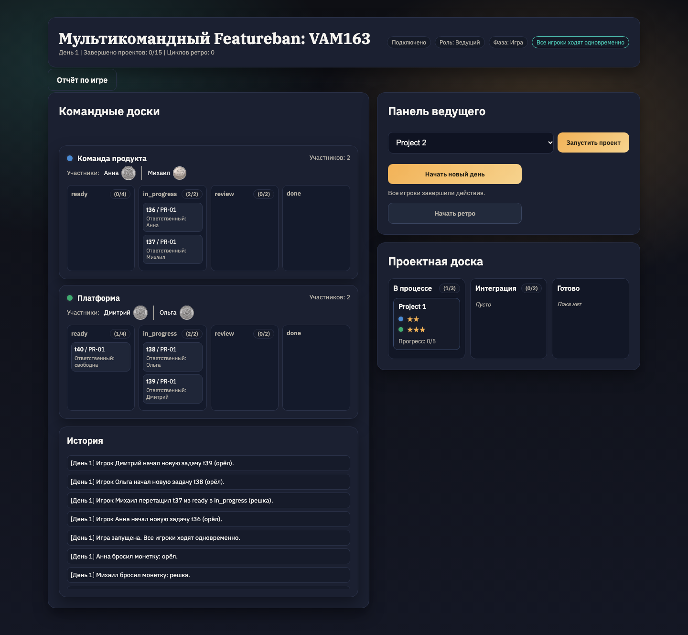
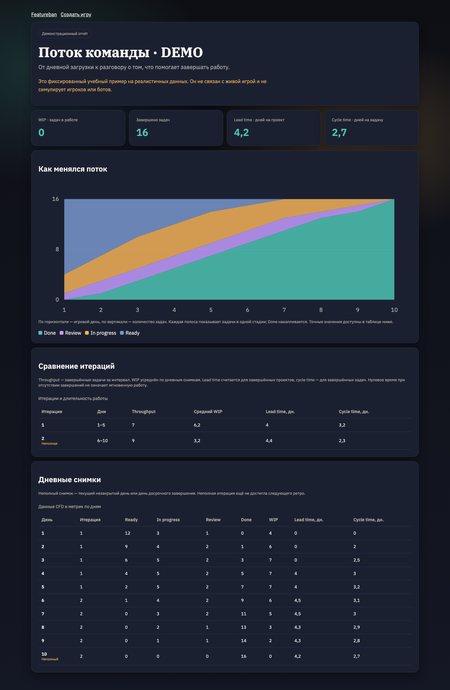

# Мультикомандный Featureban

Онлайн-симуляция для обучения команд работе с потоком задач: общая доска проектов,
командные доски, блокировки, интеграция и ретроспективы.

Это личное развитие [командного проекта ВШЭ](https://github.com/yoyojin-dev/hse-course-project-2025).
История и авторство исходной работы сохранены. В этом форке добавлены сессии участников,
восстановление партий, отчёты по дням и итерациям, CSV и демонстрационный пример.

<details>
<summary>Скриншоты игры и отчёта</summary>





</details>

## Запуск

Нужны Docker с Compose и Make. Из корня репозитория:

```sh
make up
```

Откройте [localhost:8080](http://localhost:8080). На главной доступны создание игры,
вход по коду и пример отчёта с пометкой «демо». Пример содержит учебные данные;
он не является результатом реального тренинга.

```sh
make logs                     # журналы контейнеров
make down                     # остановка с сохранением партий
FEATUREBAN_PORT=8081 make up   # другой локальный порт
```

Данные находятся в Docker-volume `game-data`. Пересоздание контейнеров сохраняет
партии; удаление volume удаляет базу. Исходный VPS и его сертификаты для запуска не нужны.

## Как провести игру

1. Создайте комнату и задайте команды. Сохраните код или ссылку приглашения.
2. Участники открывают приглашение, выбирают команду и вводят свободный ник.
3. Ведущий запускает проект, затем игру. Карточки проекта появляются на командных досках.
4. Все игроки действуют в течение одного игрового дня. Выпавшая монета определяет
   доступные действия; подсказка на доске объясняет текущий ход. Карточки можно
   перемещать кнопками или перетаскиванием.
5. Ведущий переводит игру на следующий день. На границе ретро используется кнопка
   «Начать ретро»: можно обсудить поток, изменить WIP и состав команд, затем продолжить.
6. Игра завершается после выполнения всех 15 проектов. Итоговый отчёт остаётся доступен ведущему.

WIP в исходных правилах отображается как ориентир, а не запрещает перемещение.
Параметр API `max_days` сохраняется, но не завершает игру автоматически.

Браузер сохраняет роль в комнате на 7 дней через HttpOnly-cookie. Обновление страницы
и перезапуск приложения не требуют повторного входа. Знание ника или публичного ID
не восстанавливает доступ; занятый ник отклоняется. Для нескольких участников в одном
браузере используйте отдельные профили или изолированные браузерные контексты.

## Отчёт

Ведущий открывает отчёт из игры. Он содержит распределение карточек по стадиям по дням,
текущий WIP, завершённые задачи и сравнение интервалов между ретро. Текущий день и
последний незавершённый интервал помечаются как неполные. CSV содержит одну строку на день.

- WIP — число карточек в `in_progress` и `review`.
- Throughput — сколько карточек завершено за день или интервал.
- Lead time — среднее время завершённых проектов от старта до окончания, включая оба дня.
- Cycle time — среднее время завершённых карточек от начала работы до окончания, включая оба дня.

Снимок дня фиксируется перед переходом к следующему. Границы сравнения совпадают с
фактическими ретроспективами; различие показателей само по себе не доказывает эффект изменения WIP.

## Разработка и проверки

Нужны Go 1.26, Node.js 24 и Python 3.12+. Для работы без Docker запустите бэкенд и Vite
в двух терминалах:

```sh
cd app/backend
go run .
```

```sh
cd app/frontend
npm ci
npm run dev
```

Vite доступен на [localhost:3000](http://localhost:3000) и проксирует API на порт 8080.
`PORT` задаёт порт бэкенда, `DATABASE_PATH` — путь SQLite (по умолчанию `data/featureban.db`).

```sh
(cd app/backend && go test -race ./...)
(cd app/frontend && npm test && npm run build)
python3 -m venv .venv
.venv/bin/pip install -r requirements-dev.txt
.venv/bin/python -m pytest -q
(cd app/frontend && npx playwright install chromium && npm run test:e2e)
```

CI выполняет эти проверки для изменений в репозитории. HTTP и WebSocket используют
номер версии состояния; запоздавший ответ не заменяет более новую доску. Изменения
записываются в SQLite до подтверждения и рассылки участникам.

### API

| Метод и маршрут | Назначение |
| --- | --- |
| `POST /api/create` | Создать комнату и сессию ведущего |
| `POST /api/join` | Создать участника со свободным ником и его сессию |
| `GET /api/game/{code}` | Публичное состояние комнаты |
| `GET /api/game/{code}/me` | Собственная роль из сессии браузера |
| `POST /api/game/{code}/{action}` | Игровое действие от имени своей сессии |
| `GET /api/game/{code}/report` | Отчёт ведущего в JSON |
| `GET /api/game/{code}/report?format=csv` | Выгрузка отчёта ведущего |
| `GET /ws/game?code={code}` | WebSocket публичного состояния |

Приложение рассчитано на один процесс бэкенда и небольшие игровые группы.
Публичный хостинг требует отдельной настройки HTTPS и резервного копирования.

## Авторы исходного проекта

Проект разработан студентами ФКН НИУ ВШЭ, образовательная программа
«Прикладная математика и информатика»:

- Бакунц Арина Александровна
- Денисов Николай Дмитриевич
- Овчаров Иван Евгеньевич
- Мостова Александра Александровна
- Сухобок Тимофей Михайлович
- Чупрына Матвей Михайлович

Руководитель: Коротков Александр Олегович, АО «Т-Банк».
Оригинальная симуляция Featureban — Mike Burrows. Лицензия проекта:
[Creative Commons Attribution-ShareAlike 4.0](LICENSE).
